# 🎄 The Letter of December 24th ✉️

> *Twenty-four doors, twenty-four riddles, one letter that arrives just in time for Christmas Eve.* ❄️

A personal Advent calendar for 2026, built as a story-driven puzzle game for one player: Larissa.

It's Vienna in December, at the Grand Hotel Morgenstern, and a letter written in 1926 is on its way to be delivered on Christmas Eve, a hundred years late. Each day from December 1st to 24th unlocks one chapter of the mystery. Every chapter is illustrated and narrated, and ends with a riddle. Solving it reveals what happens next, and along the way Larissa collects six vintage stamps, each carrying a letter and a postmark.

  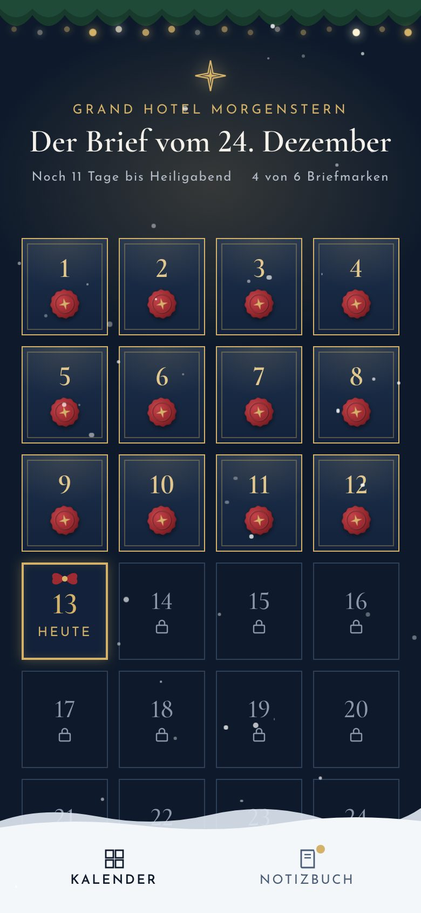
  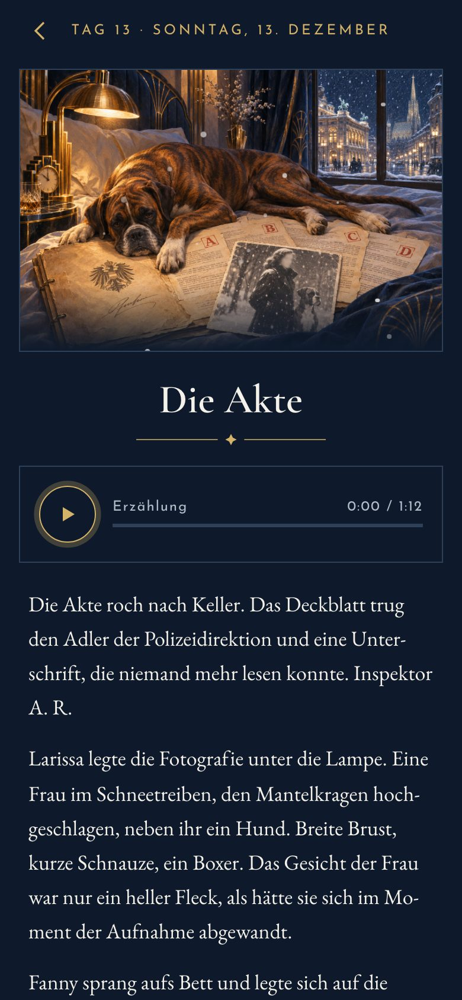
  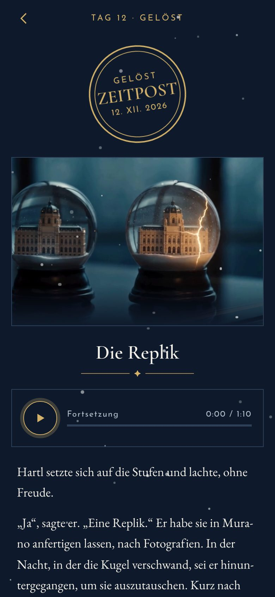
  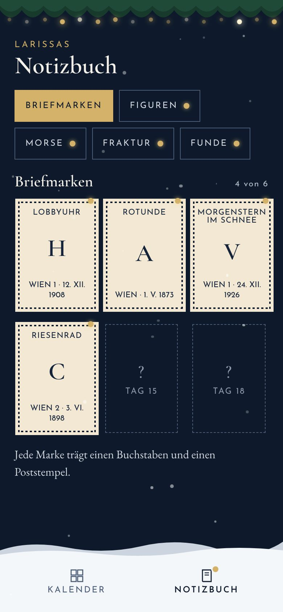

## ✨ What's inside

- **24 chapters** that unlock one per day at midnight, Vienna time
- **Illustrations and short videos** for every chapter, plus a narrated voice track for each one
- **Riddles of all kinds**: codes, a safe, spot-the-difference, footprints, a flashlight search, Morse and Fraktur
- **A notebook** that fills up as the story goes on: stamps, characters, clues and decoding tables
- **Little touches**: snow, garland lights, a wax seal on every solved door, and a finale on December 24th

## 📮 The physical part

The app is only half of the game. Each day starts with a printed **A5 card** that tells the beginning of the chapter, poses the riddle and has a QR code that opens the day in the app. Along the way, **printed inserts** turn up around the house: the handwritten letter from 1926 and its envelope, a police file with witness statements, the night porter's log, notes hidden in books and a few small pieces to cut out.

  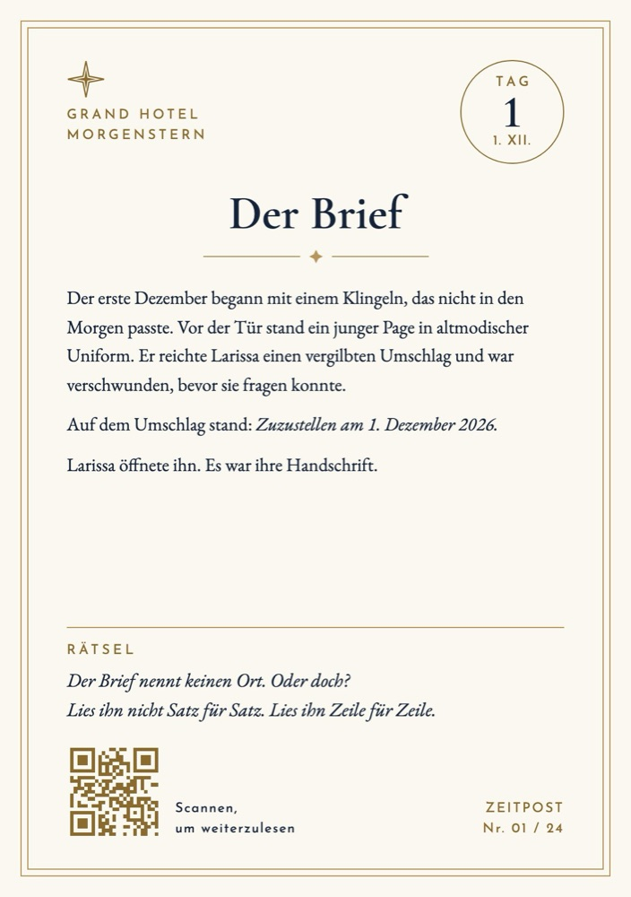
  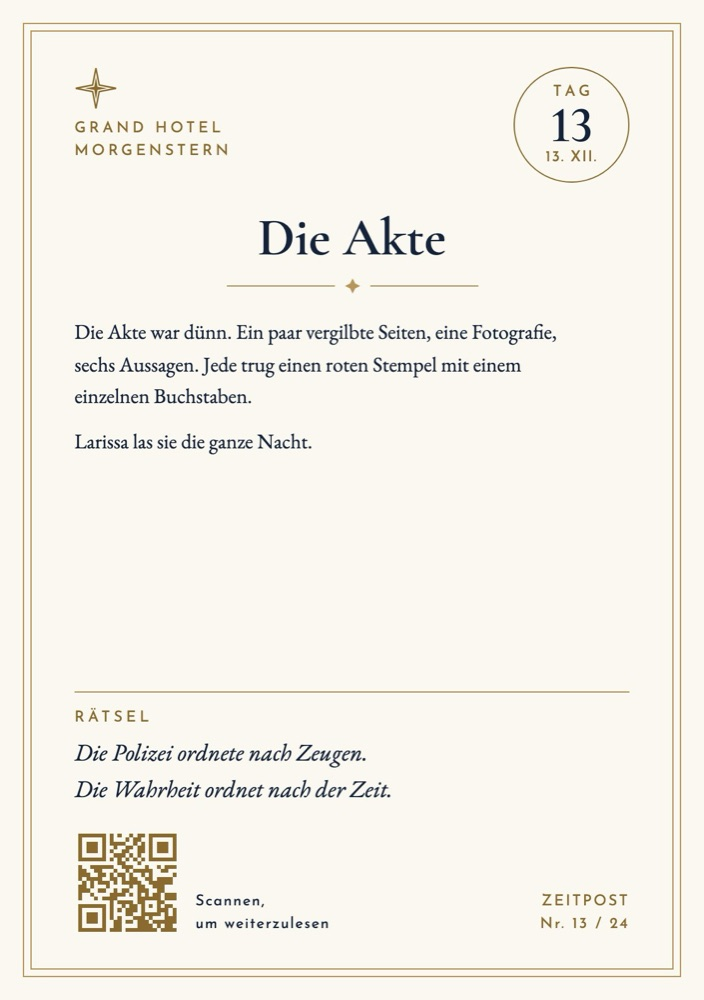
  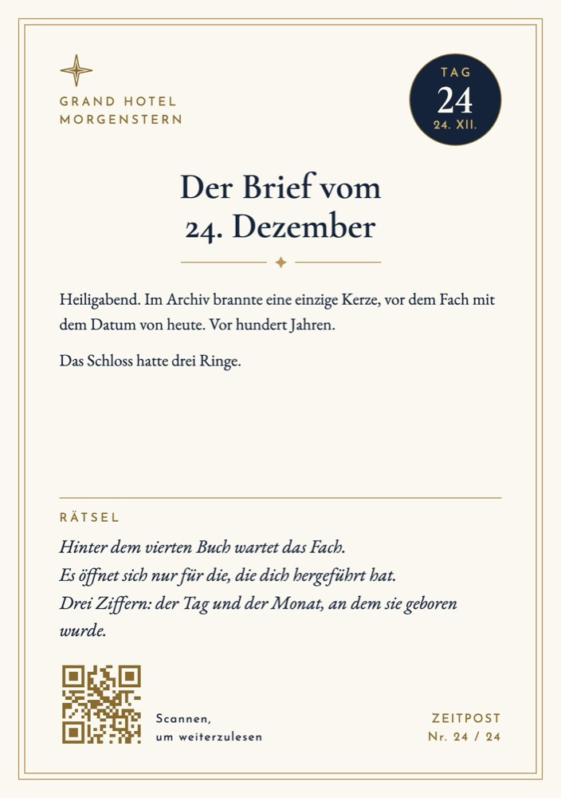

  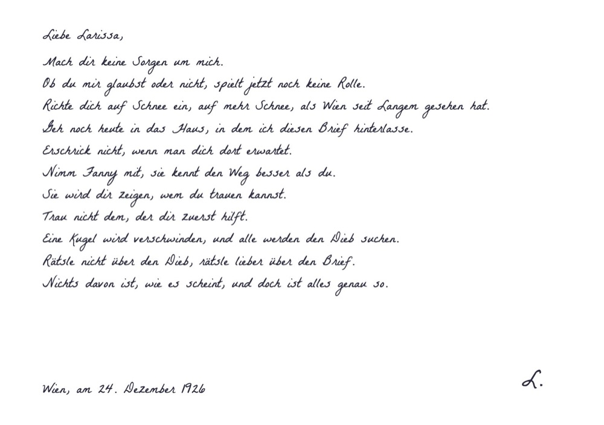
  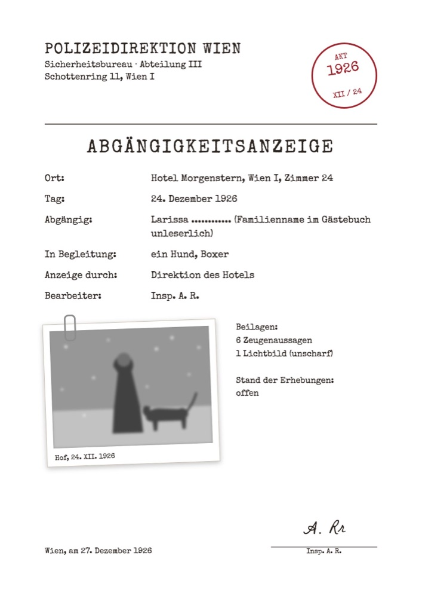
  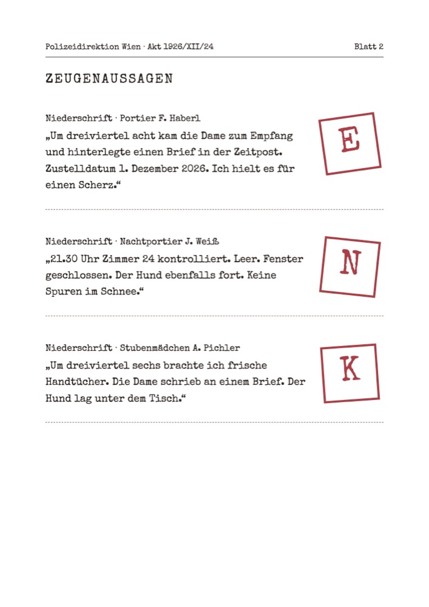
  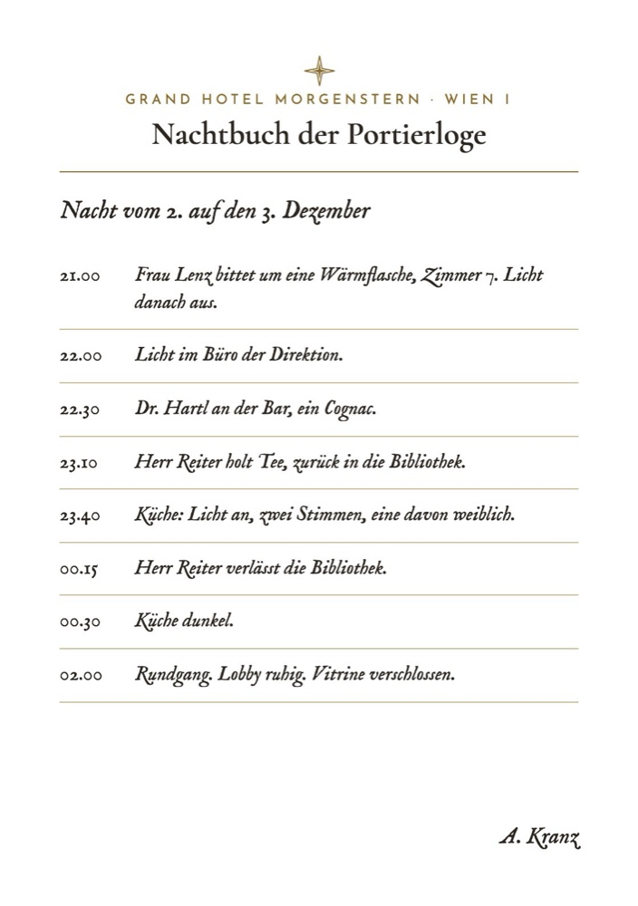

All 24 cards and the inserts are designed print-ready. If you'd like them for your own Advent calendar, [get in touch](https://github.com/birsi).

## 🛠️ Built with

Vite, React and TypeScript, with no backend: progress stays on the device. The images and voices were made with AI tools, sound effects come from Freesound, and the app is hosted on Vercel.

Frohe Weihnachten! 🌟
